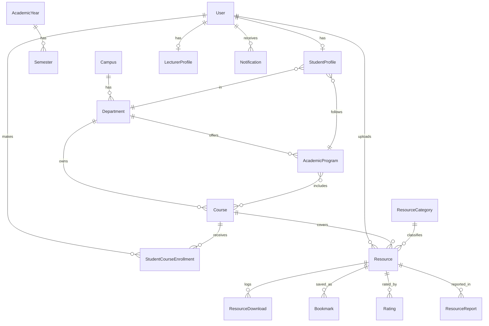

# Architecture

Modular monolith (Django). Each app owns its models, forms, services and templates.

```
Browser -> Django (WhiteNoise static) -> PostgreSQL
                                      -> Object storage (private, from Increment 2)
                                      -> Recommendation module (Increment 4)
```

## Implemented in Increment 1
`accounts` (User, StudentProfile, LecturerProfile), `academics` (Campus, Department,
AcademicProgram, AcademicYear, Semester, Course, StudentCourseEnrollment), `core`.

## Planned ERD (Increments 2-5 shown dashed in the final report)

Design note: documents and videos will share one `Resource` model with a `kind` field,
rather than two near-identical tables.
